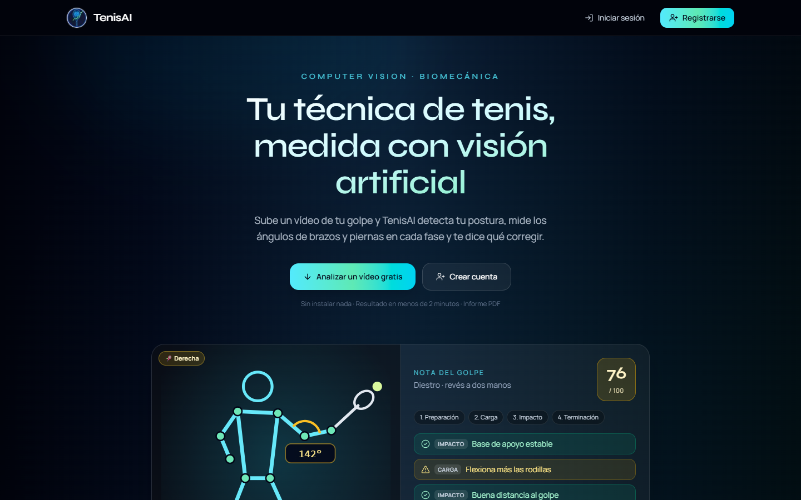
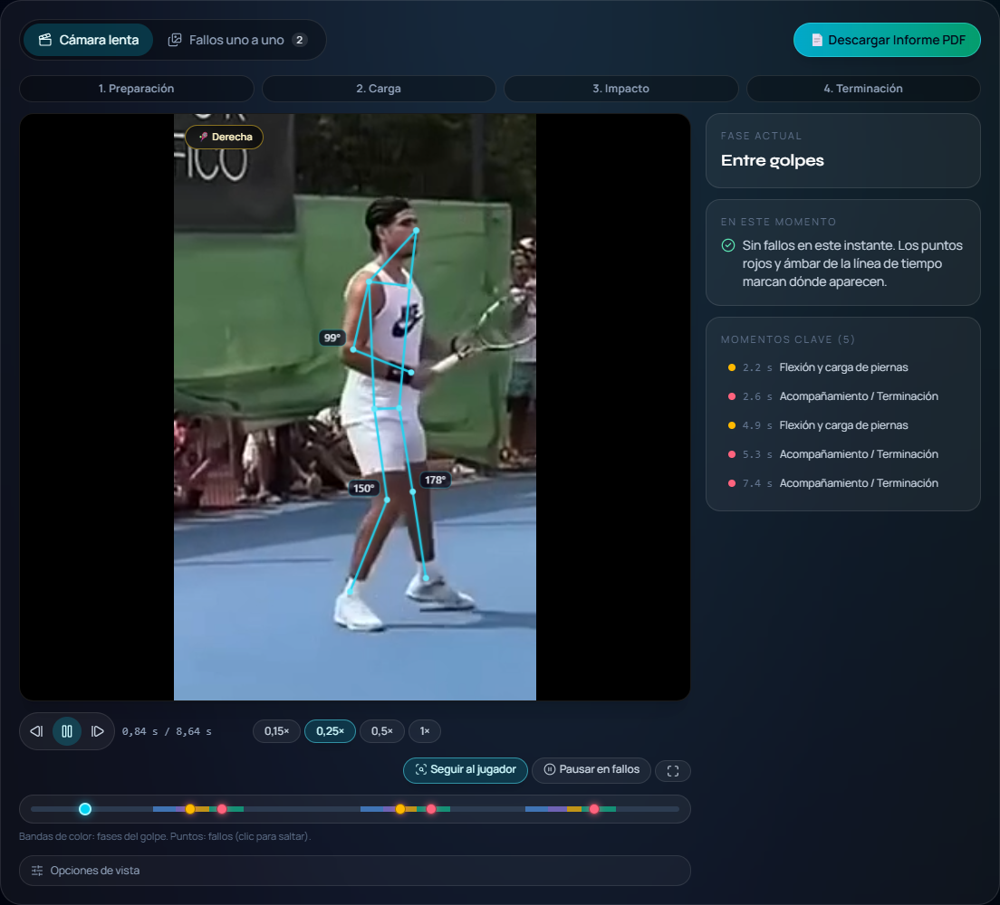
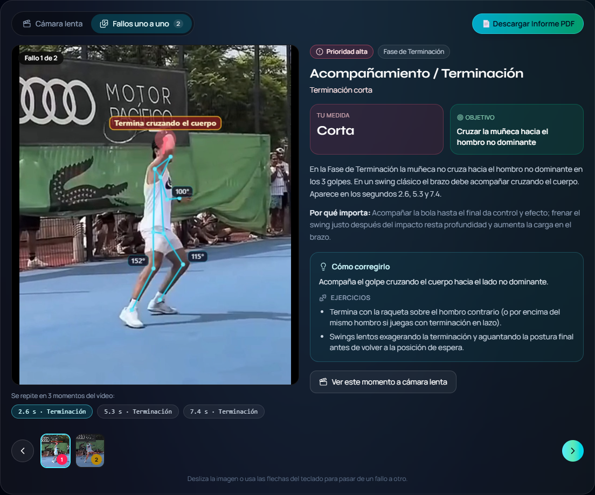
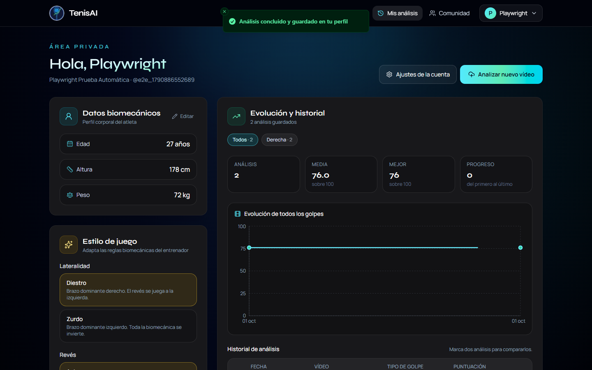
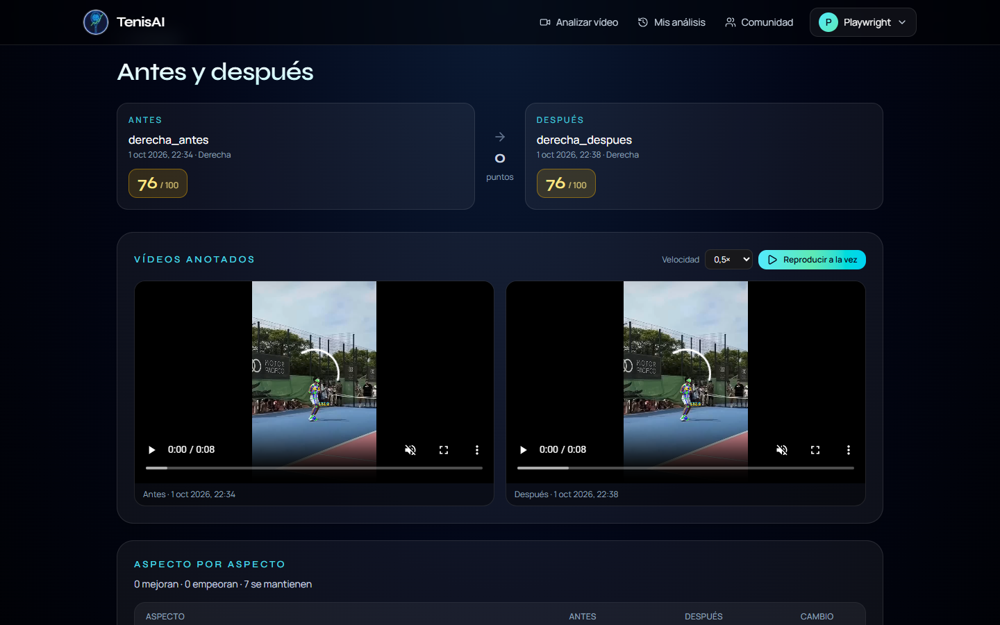
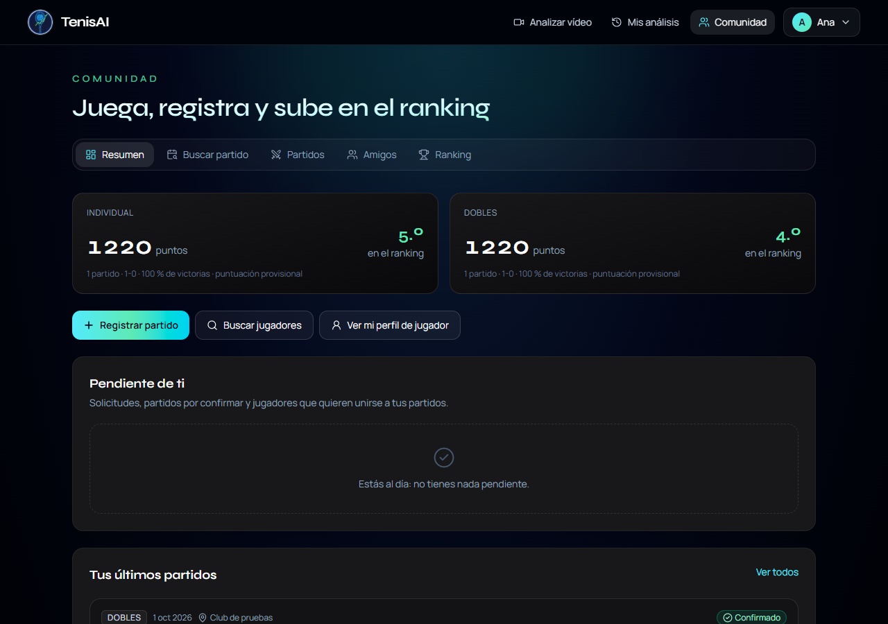
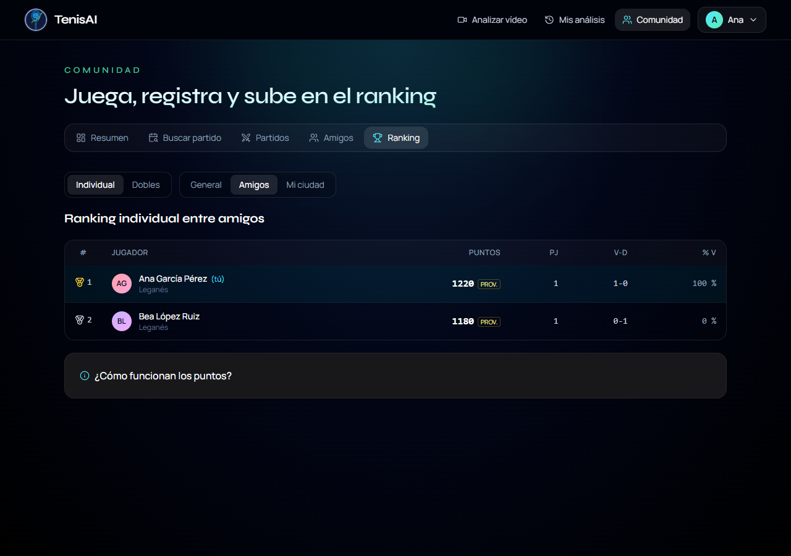
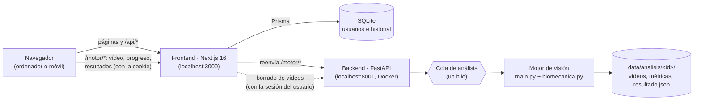

# TenisAI — Análisis biomecánico del tenis con visión artificial

Trabajo Fin de Grado. TenisAI analiza un vídeo de un golpe de tenis: detecta la
postura del jugador fotograma a fotograma, mide los ángulos de brazos y piernas en
cada fase del golpe (preparación, carga, impacto y terminación), reconoce el tipo de
golpe y devuelve una nota, consejos de entrenador y un informe PDF. Con una cuenta,
cada análisis queda en un historial para ver la evolución y comparar el antes y el
después.



| Cámara lenta con zoom al jugador | Fallos uno a uno |
| --- | --- |
|  |  |
| **Historial y evolución** | **Antes y después** |
|  |  |
| **Comunidad** | **Ranking** |
|  |  |

> Las capturas se generan con los tests de extremo a extremo
> (`CAPTURAS=1 npx playwright test`, ver [Tests](#tests)).

## Funcionalidades

- **Análisis biomecánico**: esqueleto con MediaPipe, pelota con YOLOv8, ángulos de
  codo y rodillas, apertura del hombro, distancia al golpe (*spacing*), base de apoyo e
  inclinación del tronco, con reglas adaptadas al tipo de golpe, la lateralidad y el
  estilo de juego (revés a una o dos manos, terminación clásica o «lazo», derecha con el
  brazo recto o con el codo flexionado). Cada golpe
  del clip se clasifica por separado (teniendo en cuenta si se graba de frente o de
  espaldas), así que un vídeo con derechas y reveses evalúa cada uno con sus reglas; al
  subir el vídeo también se puede indicar qué golpe es. La base y el *spacing* se miden con las coordenadas 3D de
  MediaPipe (no dependen del ángulo de grabación) y las articulaciones poco visibles
  no entran en las medias.
- **Cámara lenta**: vídeo a 0,15×–1× con el esqueleto superpuesto, zoom que sigue al
  jugador, avance fotograma a fotograma, pausa automática en los fallos y un panel que
  explica en cada instante la fase y el fallo (medida, objetivo y cómo corregirlo).
- **Fallos uno a uno**: carrusel con una imagen nítida de cada fallo, recortada al
  jugador y con la zona marcada, ordenado por prioridad, con explicación, ejercicios y
  salto a ese momento en cámara lenta.
- **Plan de mejora**: qué corregir primero, ejercicios y lo que ya se hace bien;
  informe PDF descargable.
- **Cola de análisis**: los vídeos se procesan de uno en uno y la web muestra cuántos
  hay por delante.
- **Cuentas**: registro con consentimiento, inicio de sesión, edición del perfil,
  cambio de contraseña, descarga de los datos (JSON) y borrado de la cuenta.
- **Historial**: evolución por tipo de golpe, detalle de cada análisis, comparación de
  dos análisis (vídeos sincronizados y aspecto por aspecto) y borrado.
- **Sin cuenta** también se puede analizar; ese análisis se borra a las 24 horas.
- **App instalable** (PWA) desde el navegador del móvil, con su icono y a pantalla completa; botón para **grabar el golpe con la cámara**, barra de navegación
  inferior, respeto de la muesca y página propia sin conexión. Admite los vídeos tal como
  salen del móvil (MP4 de Android o MOV/HEVC de iPhone, hasta 150 MB y 90 s): el motor los
  normaliza a MP4 H.264 aplicando la rotación del móvil y limitándolos a 1280 px y 60 fps.
- **Comunidad**:
  - perfil de jugador (ciudad, club, nivel, disponibilidad), privado por defecto;
  - buscador de jugadores, amistades, bloqueo y denuncias;
  - **Buscar partido**: publicas día, hora, lugar, nivel y cuántos jugadores te faltan; otros
    piden plaza, tú decides, y después registras el resultado con los jugadores ya puestos;
  - **Torneos** de eliminatoria que solo crean los organizadores (clubes): inscripción
    individual o por parejas (la pareja acepta), cuadro sorteado con cabezas de serie por
    puntos y pases directos, resultados anotados por el organizador que cuentan para el
    ranking, y títulos de campeón en el perfil;
  - partidos individuales y de dobles con su marcador, que cuentan cuando un rival confirma
    el resultado;
  - puntos **Elo** separados para individual y dobles, ranking general, entre amigos y por
    ciudad, y perfil con la evolución de los puntos y los enfrentamientos.

## Arquitectura



| Pieza | Tecnología | Responsabilidad |
| --- | --- | --- |
| `frontend/` | Next.js 16 (App Router), React 19, Tailwind 4, Prisma + SQLite | Interfaz, cuentas y sesiones (JWT en cookie `httpOnly`), historial, comunidad y ranking |
| `api.py` | FastAPI | Recepción de vídeos, cola, progreso, resultados, borrado, límites por usuario |
| `main.py` | OpenCV, MediaPipe Pose, YOLOv8 | Pose, pelota, ángulos, vídeo anotado, CSV y `pose_tracks.json` |
| `geometria.py` | NumPy, SciPy | Ángulos, medidas en 3D, métricas por frame y filtros (sin OpenCV: se prueba con pytest) |
| `biomecanica.py` | Python estándar | Fases del golpe, tipo de golpe, reglas, nota y consejos |

El navegador solo habla con la web: lo que pide en `/motor/...` lo reenvía Next al backend
(`rewrites` de `next.config.ts`), con la cookie de sesión y las peticiones parciales de los
vídeos. Así todo comparte un origen (sin CORS), igual en el ordenador, en la app y en
producción, donde ese reenvío lo hace Caddy (ver [Producción](#producción)).

**Flujo de un análisis**

1. El navegador sube el vídeo a `POST /motor/analizar-video` con la cookie de sesión. El
   backend identifica al usuario (o la IP si es anónimo), aplica los límites y lo pone
   en la cola.
2. El hilo de la cola lo normaliza con ffmpeg (formato, rotación, tamaño y fotogramas por
   segundo), lo procesa en `data/analisis/<id>/` y escribe un `resultado.json`.
   El navegador consulta `GET /progreso/<id>` mientras tanto.
3. Al terminar, el frontend guarda en SQLite el análisis con su `jobId`. La página
   `/analisis/<id>` lo vuelve a mostrar pidiendo `GET /resultado/<jobId>`.

## Puesta en marcha

Requisitos: **Docker Desktop**, **Node.js 20+**.

```bash
# 1. Variables del frontend (y clave de sesión que comparte el backend)
cp frontend/.env.example frontend/.env.local
#    y rellena JWT_SECRET con una clave larga:
node -e "console.log(require('crypto').randomBytes(32).toString('hex'))"

# 2. Backend (motor de visión) en Docker → http://localhost:8001
docker compose up -d

# 3. Frontend → http://localhost:3000
cd frontend
npm install
npx prisma migrate deploy
npm run dev
```

En Windows, `arrancar.bat` levanta el backend y el frontend de una vez. Si el Control de
aplicaciones de Windows bloquea el compilador nativo de Next (`next-swc…node`, sin firma),
arranca solo en modo compatible (`npm run dev:webpack`, con el compilador en WebAssembly):
funciona igual, pero cada página tarda más la primera vez.

### Cuentas de organizador

Solo los organizadores (clubes) pueden crear torneos. El rol lo da quien administra TenisAI:

```bash
cd frontend
npm run organizador -- usuario --organizacion "Club de Tenis Leganés"
npm run organizador -- usuario --quitar
npm run organizador -- --lista
```

### Datos de ejemplo de la comunidad

Para enseñar la comunidad sin otros usuarios reales hay un script que crea doce jugadores
ficticios (`demo_…`, con perfil público y sin posibilidad de iniciar sesión), amistades, unos
sesenta partidos confirmados con sus puntos, cinco partidos que buscan jugadores y un club
organizador con un torneo terminado (cuadro completo y campeón) y otro con la inscripción
abierta:

```bash
cd frontend
npm run demo:comunidad                      # crea los jugadores y partidos de ejemplo
npm run demo:comunidad -- --para tu_usuario # y además te conecta con ellos
npm run demo:comunidad -- --borrar          # lo borra todo y recalcula los puntos
```

Con `--para`, tu cuenta recibe cuatro amigos, una solicitud de amistad, un partido por
confirmar y plaza en un partido de pasado mañana.

### Variables de entorno

| Variable | Dónde | Por defecto | Para qué |
| --- | --- | --- | --- |
| `JWT_SECRET` | `frontend/.env.local` (el backend lo lee del mismo archivo) | clave de desarrollo | Firmar y verificar las sesiones. **Obligatoria en producción** (≥ 32 caracteres) |
| `DATABASE_URL` | `frontend/.env` | `file:./dev.db` | Base de datos SQLite |
| `API_INTERNAL_URL` | frontend | `http://localhost:8001` | Dirección del backend desde el servidor de Next (reenvío de `/motor` y borrados) |
| `NEXT_PUBLIC_API_URL` | frontend | `/motor` | Dirección del backend desde el navegador; solo para llamarlo directamente |
| `NEXT_PUBLIC_SITE_URL` | frontend | `http://localhost:3000` | URL pública (imágenes al compartir enlaces) |
| `API_PUBLIC_BASE` | `docker-compose.yml` | `/motor` | Base de las URLs de los vídeos que devuelve el backend |
| `FRONTEND_ORIGINS` | `docker-compose.yml` | `http://localhost:3000` | Orígenes permitidos por CORS (si el navegador llama al backend directamente) |
| `FORWARDED_ALLOW_IPS` | backend | `127.0.0.1` | Proxies de los que el backend acepta la IP del cliente (`X-Forwarded-For`) |

## Producción

Pensado para un servidor propio (un VPS con Docker; el motor de visión va mejor con 4
núcleos y 8 GB de RAM). Caddy recibe todo por HTTPS, pide y renueva el certificado solo, y
reparte: `/motor/*` al motor y el resto a la web. Solo Caddy tiene puertos abiertos.

```bash
# En el servidor, con el dominio ya apuntando a su IP y los puertos 80 y 443 abiertos
cp .env.produccion.example .env      # DOMINIO y JWT_SECRET
docker compose -f docker-compose.prod.yml up -d --build
```

- La web se compila en su propia imagen (`frontend/Dockerfile`, salida `standalone` de
  Next) y aplica las migraciones pendientes al arrancar.
- Datos en volúmenes de Docker: `web_datos` (base de datos SQLite) y `motor_datos` (vídeos
  y resultados). Son lo que hay que copiar en las copias de seguridad.
- El motor acepta la IP real del cliente que le indica Caddy (`FORWARDED_ALLOW_IPS`), así
  que el límite de análisis anónimos es por persona.
- Organizadores: `docker compose -f docker-compose.prod.yml exec frontend node
  scripts/organizador.mts usuario --organizacion "Club"` (mismas opciones que en local).
- Antes de abrirlo al público: rellenar `frontend/lib/legal.ts` y revisar la licencia de
  YOLOv8 (ver [Limitaciones](#limitaciones-conocidas)).

## Desde el móvil

La web está pensada también para el móvil: se puede instalar como app (PWA) desde el
menú del navegador («Añadir a pantalla de inicio») y grabar el golpe con la cámara.

En desarrollo, con `npm run dev` en marcha, se abre desde un móvil de la misma wifi en
`http://<IP del ordenador>:3000`. El cortafuegos de Windows tiene que permitir conexiones
entrantes al puerto 3000 (Windows lo pregunta la primera vez que Node escucha en la red).

## Tests

```bash
# Motor biomecánico y API (pytest)
python -m venv venv
venv/Scripts/python -m pip install -r requirements-dev.txt
venv/Scripts/python -m pytest

# Lógica de la comunidad: puntos Elo, marcador y perfil (test runner de Node)
cd frontend
npm run test:unit

# Extremo a extremo (Playwright; el flujo completo necesita el backend en marcha)
npm run test:e2e
CAPTURAS=1 npx playwright test           # además regenera docs/capturas
```

- `tests/test_biomecanica.py`: fases, detección y clasificación de golpes (con la
  orientación de la cámara), perfiles por tipo de golpe, regularidad, puntuación,
  calidad de la grabación y `generar_feedback` con CSV sintéticos (incluida la
  inversión de lateralidad).
- `tests/test_geometria.py`: ángulos, medidas en 3D (base, separación de la muñeca,
  giro), visibilidad de las articulaciones y suavizado de las series.
- `tests/test_api.py`: cola, un análisis en marcha por usuario, límites por hora,
  sesión falsa o caducada, tamaño y formato del vídeo, ids maliciosos, borrado solo por
  el dueño y limpieza de análisis anónimos. Sustituye el motor de visión por uno falso.
- `frontend/lib/comunidad/*.test.ts`: cálculo de puntos Elo (individual y dobles, jugadores
  provisionales), validación del marcador (sets, tie-break, super tie-break, partido ya
  decidido), validación del perfil de jugador y reglas de «Buscar partido» (antelación,
  plazas, fechas en hora de España).
- `frontend/e2e/`:
  - navegación y rutas protegidas;
  - el recorrido completo de un usuario nuevo (registro → dos análisis → comparación →
    cámara lenta y fallos uno a uno → borrado → baja de la cuenta). Sube
    `data/prueba.mp4`, que no se versiona: coloca ahí cualquier vídeo MP4 corto de una
    derecha;
  - la comunidad con cuatro jugadores en navegadores distintos (amistad, partido confirmado
    con sus puntos y el ranking, resultado rechazado, dobles, perfil privado, bloqueo,
    ajustes y borrado de la cuenta);
  - «Buscar partido» con tres jugadores (publicar, filtro por ciudad, pedir plaza, aceptar,
    registrar el resultado, darse de baja y cancelar);
  - torneos con un organizador y cinco jugadores (solo crea torneos el organizador,
    inscripción, sorteo con pases directos, resultados hasta el campeón, título en el
    perfil e invitación de pareja en dobles).

Con el equipo cargado, los tests van más rápidos y estables contra una compilación de
producción (`npx next build` y `npm run start`) que contra `npm run dev`. Con
`E2E_BASE_URL` se lanzan contra otro servidor (por ejemplo la pila de producción en local);
la de torneos da el rol de organizador con el script sobre la base de datos local, así que
solo funciona contra la web de este ordenador.

Calidad del frontend: `npm run typecheck` y `npm run lint`.

## Seguridad y privacidad

- Contraseñas con bcrypt; sesión en un JWT firmado dentro de una cookie `httpOnly`.
  Cambiar la contraseña cierra las sesiones abiertas en otros dispositivos.
- El backend solo borra vídeos con un permiso firmado de un solo uso (60 s) que emite
  el frontend; la cookie de sesión no basta.
- Registro solo para mayores de 14 años (edad de consentimiento digital en España).
- Límite de intentos de inicio de sesión (por IP + usuario, por usuario y por IP) y al
  confirmar la contraseña con la sesión iniciada.
- El backend verifica la sesión, limita a un análisis en marcha y un número por hora,
  valida formato y tamaño, y solo deja borrar un análisis a su dueño.
- RGPD: consentimiento registrado, descarga de datos, rectificación, borrado de la
  cuenta con todos sus vídeos y borrado automático de los análisis anónimos.
- Comunidad con privacidad desde el diseño:
  - el perfil de jugador es privado por defecto, y a quien no es amigo solo se le muestra
    el nombre con la inicial del apellido;
  - la edad, la altura, el peso y los análisis nunca se muestran a otros usuarios;
  - solo se puede apuntar en un partido a amigos o perfiles públicos, y el partido no cuenta
    hasta que un rival lo confirma;
  - la confirmación aplica los puntos en una transacción que no se puede duplicar;
  - hay bloqueo en ambos sentidos, denuncias y límites diarios de solicitudes, partidos y
    denuncias.
- Rellena los datos del responsable en `frontend/lib/legal.ts` antes de publicar.

## Limitaciones conocidas

- La cola y los límites de peticiones viven en memoria: valen para un único servidor.
  Con varias instancias habría que usar Redis o similar.
- El ranking se calcula en cada visita a partir de todos los jugadores con partidos: va bien
  con cientos de usuarios; con muchos miles habría que precalcularlo o paginarlo.
- Los puntos se aplican en el orden en que se confirman los partidos, no en el orden en que
  se jugaron. Un partido confirmado ya no se puede retirar.
- Los vídeos y resultados se protegen con un identificador aleatorio de 128 bits (como
  un enlace privado), sin comprobar la sesión en cada petición.
- En desarrollo, el reenvío de `/motor` de Next copia en memoria cada vídeo que sube (hasta
  160 MB) y el backend ve a todos los anónimos con la misma IP. En producción lo reenvía
  Caddy, sin esas limitaciones.
- Ultralytics (YOLOv8) se distribuye con licencia **AGPL-3.0**: si TenisAI se ofrece
  públicamente como servicio, hay que publicar su código bajo una licencia compatible o
  adquirir una licencia comercial. MediaPipe usa Apache 2.0.

## Estructura

```
api.py               API FastAPI (cola, sesiones, límites, resultados)
main.py              Motor de visión: pose, pelota, ángulos, vídeo anotado
geometria.py         Ángulos, medidas 3D, métricas por frame y filtros
biomecanica.py       Reglas biomecánicas, fases y tipo de golpe
tests/               Tests de pytest
data/analisis/       Un directorio por análisis (montado como volumen)
models/              Modelos de MediaPipe y YOLOv8
frontend/
  app/               Páginas y rutas de API de Next.js
  components/        Componentes (reproductor, resultados, perfil, portada…)
  lib/               Sesión, validación, límites, formato, textos legales
  prisma/            Esquema y migraciones de la base de datos
  e2e/               Tests de Playwright
  lib/comunidad/     Puntos Elo, marcador, amistades, partidos y ranking (con sus tests)
  scripts/           Iconos e imágenes; datos de ejemplo; organizadores
  Dockerfile         Imagen de la web para producción
docker-compose.prod.yml, Caddyfile   Producción con HTTPS
docs/capturas/       Capturas del README
```
